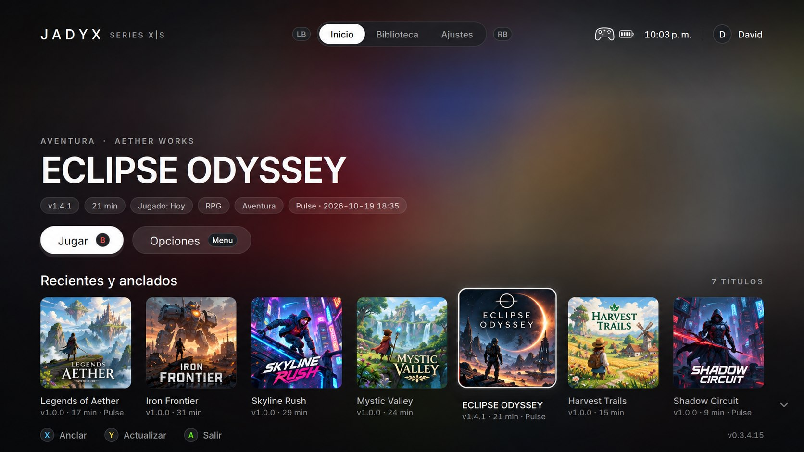
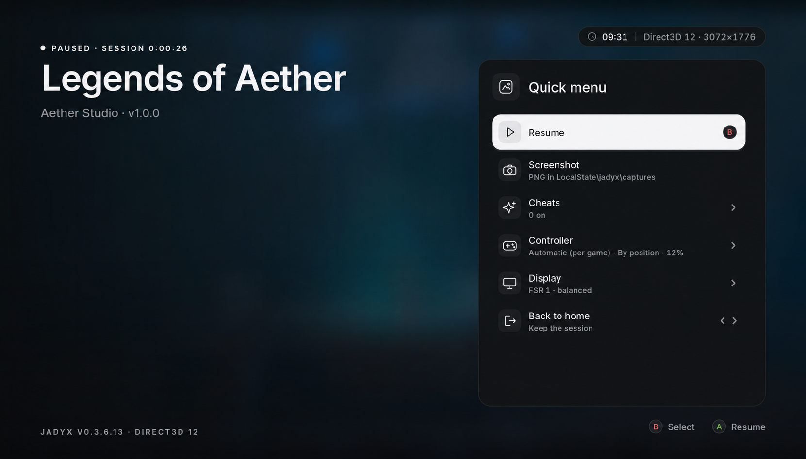
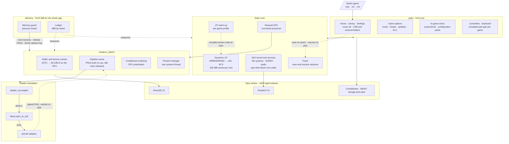

<!--
SPDX-FileCopyrightText: Copyright 2026 Eden Emulator Project
SPDX-License-Identifier: GPL-3.0-or-later
-->

<p align="center">
  
</p>

<h1 align="center">Jadyx</h1>

<p align="center">
  A Nintendo Switch emulator for <b>Xbox Series X|S in Developer Mode</b>, based on Eden,<br>
  with a <b>native Direct3D 12 renderer</b> written for this port.<br>
</p>

<p align="center">
  <a href="https://github.com/JulianDr14/jadyx/releases/latest"><b>Download the latest release</b></a> ·
  <a href="https://discord.gg/3BhyyXGxpd"><b>Discord</b></a> ·
  <a href="https://github.com/JulianDr14/jadyx/issues/new/choose"><b>Report a bug</b></a>
</p>

<p align="center">
  <br>
  <sub>The home screen. The games shown are made-up placeholders with original artwork: no Nintendo
  images, names or game assets are used.</sub>
</p>

<p align="center">
  <br>
  <sub>The in-game quick menu. Hold <b>View + Menu</b> on the controller while playing to open it.</sub>
</p>

> **Beta.** Some games reach gameplay on the console and none is free of bugs. It contains no keys,
> firmware or games and never will: use only the ones you dumped from a console and games you own.
> See [Legal](#legal).

**Contents:** [Progress](#progress) ([the memory wall](#the-memory-wall)) ·
[Architecture](#architecture) · [Running it on a console](#running-it-on-a-console) ·
[Building](#building) · [Documentation](#documentation) · [Acknowledgements](#acknowledgements) ·
[Legal](#legal) · [License](#license)

## Progress

### Games

Tested only with dumps of games the tester owns, on retail Xbox Series X|S consoles in Developer
Mode with the app in Game mode. Figures are measured once the game's shaders are compiled: the
first visit to a new area still stutters while its shaders build. Rows marked *community* come from
the `#compatibility` forum on [Discord](https://discord.gg/3BhyyXGxpd), where anyone can add a
report.

| Game | Console | Performance | Notes |
| --- | --- | --- | --- |
| Mario Kart 8 (32-bit) | Series X | **60 FPS** in races, stable | No graphical errors. Frames of 16.7 ms, slowest 17.1 ms mid-race; rain, reflections and particles included |
| Mario Kart 8 *(community)* | Series X | **50–60 FPS** in game | Jadyx 0.3.0.0; separate community report |
| Mario Strikers | Series X | **60 FPS** in matches, stable | No graphical errors, special-move cutscenes included. GPU at 14 % |
| Pokémon Let's Go | Series X | **60 FPS**, stable | No graphical errors |
| Mario Wonder | Series X | **55–60 FPS**, stable | No crashes or graphical errors |
| Mario Wonder *(community)* | Series S | **60 FPS** | Latest community report |
| Under Night In-Birth II Sys:Celes *(community)* | Series S | **60 FPS** | In-game; community report |
| Naruto x Boruto: Connections *(community)* | Series S | **30 FPS**, reported stable | No FPS drops reported by the tester |
| Mario 3D World | Series X | **60 FPS**, stable | In-game |
| Hades II *(community)* | Series S | **60 FPS**, reported smooth with no drops | Jadyx 0.3.8.0; community report |
| Bayonetta *(community)* | Series S | **60 FPS**, dropping to **42 FPS** during combos | Jadyx 0.3.8.0; community report |
| Bayonetta 2 *(community)* | Series S | **60 FPS**, dropping to **30–40 FPS** during heavy action and combat | Jadyx 0.3.8.0; community report |
| Super Mario Odyssey | Series X | **45–50 FPS** in very open areas; **60 FPS** in more enclosed areas and in certain levels | In-game |
| 13 Sentinels *(community)* | Series X | **60 FPS** in battles and exploration | Playable |
| NEO TWEWY *(community)* | Series X | **20–30 FPS** in game, 50 in menus | In-game; drops to 10–17 FPS while new shaders compile |
| Pokémon Sword *(community)* | Series S | **20–30 FPS** | Reported stable apart from roughly one-second stutters, possibly shader compilation. Open areas still to be tested; build not specified |
| Yo-kai Watch 4++ *(community)* | Series S | **30 FPS** in the intro and menus; **20 FPS** reported in the open world | In 0.3.0 it froze on a white screen when starting the game; 0.3.5 gets past it. The tester now confirms gameplay and reports stable operation despite open-world FPS drops. Work in progress |
| Hyrule Warriors AoC *(community)* | Series X | **30 FPS** in cutscenes | In 0.3.0 it crashed at the same point after the first cutscene; 0.3.5 gets in-game. Work in progress |
| The Legend of Zelda: Breath of the Wild | Series X | **27–29 FPS** observed in the open world with shaders compiled | Previously about 23 FPS in the tested open area. Holds 30 FPS in lighter areas; work in progress |
| Zelda TotK | Series X | Renders **without graphical errors**, then **hits the memory wall** | The heaviest loads need more than the app's 5120 MiB, see [The memory wall](#the-memory-wall). On PC it reaches the open world at **30 FPS** |

For Hades II and both Bayonetta reports, Series S is inferred from the same tester's explicit
console identification and other compatibility reports; those three posts do not repeat the model.

Where the open world loses its frames: the renderer's GPU thread spends about 32 ms of host CPU
time recording some 4 000 draws per frame (about 8 µs per draw), while the GPU itself needs only
about 8 ms. Cutting the per-draw cost of the D3D12 backend is the next target for optimisation.

Audio works in every game tested. None has been played from start to finish, so none is called
"fully playable" yet.

### Subsystems

| Part | How it is done here | Notes |
| --- | --- | --- |
| Renderer | Own D3D12 backend, modelled on Eden's Vulkan backend | Feature level 11.0, shader model 6.4, no Agility SDK on the console. See [Inside the renderer](#inside-the-renderer) |
| Guest shaders | Eden's recompiler emits SPIR-V, Mesa's `spirv_to_dxil` turns it into DXIL, `dxil.dll` signs it | Cached on disk per game and rebuilt in parallel at boot; integer textures lowered to texel fetches |
| Pipelines | A pipeline keeps its DXIL; its PSO is built when it is drawn and released when it sits idle | The pipelines of recent sessions are built at boot (`d3d12_hot.bin`); pipelines share one copy of each stage's bindings |
| Conditional rendering | Evaluated on the GPU with `SetPredication` | The GPU thread no longer waits for query results each frame |
| CPU | Dynarmic JIT with W^X inside the AppContainer, 64-bit and 32-bit games | Code cache capped at 128 MiB per core on Xbox (`jit_cache_mib`); a per-game profile compiles known code before the game starts, see [The JIT warm-up](#the-jit-warm-up) |
| Emulated cores | Idle cores spin briefly (`MWAITX`/`UMWAIT`/`pause`) before blocking | Handoffs between cores skip most of the ~40 µs OS wake latency |
| Guest memory | Placeholder memory through the `*FromApp` APIs, committed on demand; fiber stacks grow on demand | No fastmem: every guest access goes through a page table |
| App memory | A memory guard that shrinks the caches as the 5120 MiB limit nears, and a ledger of who owns each MiB | See [The memory guard](#the-memory-guard) and [The memory wall](#the-memory-wall) |
| Textures | ASTC decoded on the GPU into BC3, or BC1 when the texture has no alpha; arrays included | `astc=bc3` keeps the CPU path, `astc_opaque=bc3` keeps every ASTC texture as BC3, `astc_arrays=rgba` keeps arrays in RGBA8 |
| Audio | XAudio2 2.9 | Same path on PC and Series |
| Front end | Home, Library and Settings tabs; library with cover art cached on disk, filters and pinned games; full-screen in-game menu (View + Menu held) with screenshots | English, Spanish and Brazilian Portuguese interface; games, keys and firmware sent from a PC or phone with the [Jadyx Portal](#jadyx-portal), or imported from a folder, ZIP or USB drive. See [The front end](#the-front-end) |
| Game options | Mods, Cheats, Updates, DLC and Pulse for each game, opened from the library | Cheats also change from the in-game menu, while playing. See [Game options](#game-options) |
| Mods | Installed in priority order; browsed and downloaded from GameBanana or the CNX index, or installed from archives on disk | `.zip`, `.7z` and `.rar`; an archive with several variants lets you pick. See [Mods](#mods) |
| Cheats | Atmosphere cheats from the game's files and the online nx-cheats-db, turned on before playing or while playing | See [Cheats](#cheats) |
| Updates and DLC | Imported from NSP or XCI, verified, kept in internal storage or read in place from USB | Several versions kept; one active at a time. See [Updates and DLC](#updates-and-dlc) |
| Input | Xbox controllers, keyboard on PC with rebindable keys | Emulated controller type (Pro, Joy-Cons, handheld) chosen per game; a chosen pad that disconnects is never silently replaced; held directions repeat in menus |
| Recovery | A GPU failure returns to the library instead of killing the app | Still being validated on the Series |
| Sessions (Pulse) | **Back to home** saves the running game; picking it again resumes it where it was | 64-bit and 32-bit games save and resume on the Series and on PC. See [Pulse: resume where you left off](#pulse-resume-where-you-left-off) |

### The memory wall

The heaviest game tested is where this port meets its hardest limit. On the Series it draws correctly,
but in the heaviest area loads the app runs out of memory: the renderer cannot create a buffer and
the game returns to the library.

**Why it does not fit.** In Game mode the whole app gets 5120 MiB, and the GPU shares that memory.
The Switch gives the game about 3.2 GiB, and this game uses almost all of it. An emulator then needs
room of its own: its JIT, its shaders and pipelines, and above all a second copy of every texture.
The game's textures sit in the emulated memory, and the GPU needs them again in a format of its own.
On a PC the second copy goes to the graphics card's memory; on the Series it counts against the same
5120 MiB.

Measured on PC, without the limit, in the load that fails on the Series:

| What | MiB | Can it shrink? |
| --- | --- | --- |
| Emulated Switch memory | 2460 | No: it is the game's own memory |
| Textures on the GPU | 1000 live in the load, up to 2000 with no limit to evict them | Only by evicting sooner or by lowering their resolution |
| Allocations of the emulator itself (C++ heaps) | 750 | Partly: about 400 MiB are large blocks not attributed yet |
| Other GPU memory (upload ring, buffers) | 460 | Already cut |
| JIT code cache | 300–400 | Now capped at 128 MiB per core; smaller caps mean more recompilation |
| The executable and its DLLs | 200 | No |

Without the textures that is about 4.25 GiB, which leaves some 870 MiB for textures under the
limit. The failing load keeps about 1000 MiB of them in use at the same time. Without the limit the
app peaks around 6.4 GiB.

**What has been cut so far:**
- PSOs are built when a pipeline is drawn and released when it sits idle, instead of all of them
  living for the whole session (about 100 KiB each, 1.3 GiB for 17 000 pipelines in one game).
- Graphics pipelines share what they read from each shader: 160 MiB → 26 MiB over 15 000 pipelines.
- The JIT code cache is capped at 128 MiB per core, and its per-block metadata is compact: link
  sites went from ~230 to ~40 bytes, block ranges from ~385 to 16–24 bytes.
- Fiber stacks commit 64 KiB and grow on demand, instead of 4 MiB each up front (about 500 MiB for
  126 fibers).
- ASTC texture arrays are recompressed to BC3 too: one array of 121 layers went from 650 MiB to a
  quarter of that.
- Texture descriptor tables are sized by the game's limit instead of a fixed 16 MiB each.
- The system fonts are loaded once instead of once per service.
- The upload ring is at most 128 MiB.
- Textures start being evicted with 768 MiB still free.
- A buffer or texture the system refuses is retried after memory is reclaimed.
- ASTC textures without alpha are re-encoded as BC1, half the size of BC3. This game uses few of
  them, so it gains little here.

**What comes next:**
- Find out what the ~400 MiB of large heap blocks are and cut them.
- An option to lower the resolution of the largest textures. It costs sharpness, but it would leave
  enough room for the heaviest loads.

Fitting in memory is not the end of it. Fastmem, which mirrors the Switch's address space in the
host's so that JIT code reaches guest memory with a single instruction, is impossible inside the
Xbox sandbox. Every memory access of the emulated CPU goes through a page table instead, and this
game leans hard on the CPU. Its frame rate on the Series is still unknown.

## Architecture

The app is one UWP executable. The same package runs on a Windows PC, which is where every change is
tried before it goes to the console.



Where things live:

| Path | What |
| --- | --- |
| `src/jadyx/` | Front end: CoreWindow boot (`app/`), library and its metadata cache (`library/`), in-game menu (`game/`), settings, interface languages (`i18n/locales/`), controllers and keyboard (`input/`), shared drawing and design tokens (`ui/`), file import and external storage (`storage/`), `jadyx_diag.txt` |
| `src/jadyx/mods/`, `cheats/`, `content/` | The game options: the mods manager and its store, cheats, the updates and DLC manager |
| `src/dynarmic/` | The JIT, with W^X for the AppContainer, the warm-up profiles and compact block metadata |
| `src/common/` | Shared pieces this port added to: the memory ledger, the spin-then-block core wait, fiber stacks that grow on demand, Pulse's archive format |
| `src/core/pulse_*` | Pulse: capture and restore of the guest process (threads, memory, kernel objects) and of each HLE service's state; the sessions in the library live in `src/jadyx/pulse_sessions.*` |
| `src/video_core/renderer_d3d12/` | The D3D12 renderer: scheduler, buffer and texture caches, pipelines, root signatures, presentation (see [Inside the renderer](#inside-the-renderer)) |
| `src/shader_recompiler/` | Eden's shader recompiler, with the adjustments the D3D12 profile needs |
| `tools/xbox/mesa/` | Our additions to Mesa's `spirv_to_dxil` (pipeline linking, integer sampling) |
| `tools/xbox/` | Build, packaging, local run, Mesa build and crash symbolication scripts |
| `tools/xbox/tests/` | Standalone tests of the pure policies: memory guard, PSO residency, JIT warm-up, controllers, library, languages, system settings, on-screen keyboard, cheats, mods |
| `dist/uwp/` | App manifest and package assets |

Two runtime DLLs are loaded from the package root: `spirv_to_dxil.dll` (built from Mesa by
`tools/xbox/build-spirv-to-dxil.ps1`) and `dxil.dll` (from the Windows SDK). If either is missing,
the renderer falls back to presenting the guest framebuffer through the CPU.

### Inside the renderer

`renderer_d3d12` follows the layout of Eden's Vulkan backend. The generic `TextureCache`,
`BufferCache`, `ShaderCache` and `FenceManager` templates, the Vulkan `StateTracker` and
`FixedPipelineState` are shared; the D3D12 part supplies their runtimes. Each file has one job:

| Area | Files | What |
| --- | --- | --- |
| Device and submission | `d3d12_device`, `d3d12_scheduler`, `d3d12_fence_manager`, `d3d12_query_cache` | Device, direct queue, command lists and allocators, GPU ticks, deferred releases, guest fences and queries |
| Presentation | `renderer_d3d12`, `d3d12_present_manager`, `d3d12_swapchain`, `d3d12_present_blit`, `d3d12_present_cpu`, `d3d12_overlay` | Composites each frame into a frame of its own; a dedicated thread copies it to the swapchain and presents (see below) |
| Draws | `d3d12_rasterizer*`, `d3d12_accelerate_dma`, `d3d12_maxwell_to_d3d12`, `d3d12_indirect_buffer`, `d3d12_conditional_rendering` | Draw state, clears, DMA, indirect draws rebuilt for `ExecuteIndirect`, conditional rendering by GPU predication |
| Pipelines | `d3d12_graphics_pipeline`, `d3d12_compute_pipeline`, `d3d12_root_signature`, `d3d12_stage_bindings`, `d3d12_pipeline_residency` | PSOs and their root arguments, stage bindings shared between pipelines, which PSOs stay built |
| Shaders | `d3d12_pipeline_cache`, `d3d12_shader_compiler`, `d3d12_linked_shader_cache` | SPIR-V → DXIL translation on worker threads, the per-game disk cache of guest pipelines, reuse of linked shaders |
| Textures | `d3d12_texture_cache`, `d3d12_image_*`, `d3d12_depth_stencil_transfer`, `d3d12_astc_gpu_decoder`, `d3d12_sampler`, `d3d12_framebuffer`, `d3d12_texture_formats` | Images, views, uploads and downloads, copies and blits, ASTC on the GPU |
| Helper shaders | `d3d12_blit_image`, `d3d12_blit_compute` | Blits, masked clears, depth-stencil packing, ASTC decode and BC1/BC3 encode |
| Memory | `d3d12_buffer_cache`, `d3d12_staging_buffer_pool`, `d3d12_transfer_buffer_pool`, `d3d12_resource_allocator`, `d3d12_heap_packing`, `d3d12_gc_readback`, `d3d12_memory_guard`, `d3d12_cache_policy` | Buffers, the upload ring, reused GPU scratch buffers, placed texture heaps and their packing, the memory guard and its pressure levels |
| Binding | `d3d12_descriptor_heap`, `d3d12_barrier_batch`, `d3d12_pipeline_helper`, `d3d12_resource_utils` | Descriptor ring and sampler heap, batched barriers, helpers shared by draws and dispatches |
| Diagnostics | `diagnostics/` | Draw trace, frame dumps, performance report, pipeline and ASTC checks; kept off the hot paths |

**Presentation.** The GPU thread composites each frame into one of three textures of its own and
submits it. A separate thread (`D3D12Present`) waits on the swapchain's frame latency waitable object,
copies the frame into the back buffer and presents it, so the GPU thread never waits for the display.
Both threads submit to the same queue under one lock, because `Present` and `ExecuteCommandLists`
racing on two threads can deadlock. Without a waitable swapchain, or with `async_present=0` in
`boot.cfg`, presentation runs on the GPU thread as before.

### The JIT warm-up

**The problem.** Dynarmic translates Switch ARM64 code to x64 the first time each block runs. On a
PC that cost hides well, but inside the Xbox sandbox every compile also has to flip the code pages
between writable and executable (W^X is mandatory in the AppContainer), and the console's CPU cores
are slower. So the first minutes of a game, and every new area, were full of small freezes that had
nothing to do with the GPU.

**What this fork does.** It remembers which code a game runs and compiles it before the game starts:

1. While you play, each emulated CPU core records the blocks it compiles: guest address, length and
   a hash of the ARM64 instructions. No host machine code is stored.
2. On exit the list is saved per game, per core and per executable build
   (`LocalState\jadyx\cache\jit-profile\<title-id>\core-N.bin`), written to a temporary file and
   renamed, so a crash never leaves a half-written profile.
3. On the next launch, before the guest runs, the cores replay their profiles in parallel, each with
   its own JIT and a budget of emitted code. The loading screen shows the progress.
   The budget is learned per game: 64 MiB per core by default, then 32 and 16. A session whose free
   memory fell below 256 MiB lowers the next one a step; a long session that always kept 1 GiB free
   raises it back. A full profile at 115 MiB per core used to cost one game 1 GiB of the limit.
4. Learning continues during play, so each session adds what the previous one missed.

**Why it is safe.** A profile is only a hint. Before a block is compiled from it, the block must sit
in executable, non-writable memory that the game loaded, and its instructions must match the stored
hash and length. A profile for another game, another update of the game or another core, or one
with a bad checksum, is discarded and the core simply learns again. A block that fails these checks
is compiled the normal way when the game reaches it. W^X and the normal invalidation of modified
code stay in place, and the warm-up never runs guest code or changes guest state.

**The result.** On PC the preload time fell by about half. It is on by default; `jit_prewarm=0` in
`boot.cfg` turns it off and `jit_prewarm=record` only learns, without the warm-up.

How this compares: Ryujinx's PPTC caches translated host code on disk; this profile stores only
*what* to compile and recompiles it each launch. That costs boot time, but nothing executable is
ever read back from disk.

### The memory guard

**The problem.** In Game mode the whole app gets a hard limit of 5120 MiB, and on the Series the
GPU shares that same memory. Past the limit, the system refuses new commits
(`CreateCommittedResource` returns `E_OUTOFMEMORY`). An app left over the limit is suspended after
two seconds. A PC emulator assumes it can grow its caches while there is room. A fixed cache size
does not work either: what fits in a 2D game is too much in an open world.

**What this fork does.** Once per frame the GPU thread measures two things: the app's commit
against its limit (`Windows.System.MemoryManager.AppMemoryUsage`, the same figure the system's
Resource Manager enforces) and the GPU's usage against its DXGI budget. It keeps a pressure level
for each, takes the worse one, and every optional consumer of memory adapts to it:

| Free memory in the app | Level | What gives way |
| --- | --- | --- |
| More than 768 MiB | Normal | Nothing; textures are evicted at the usual pace |
| 768 MiB or less | Pressure | Texture garbage collection runs more often and evicts more per frame |
| 384 MiB or less | Critical | A second, deeper eviction pass |
| 192 MiB or less | Emergency | Maximum eviction |
| 128 MiB or less | — | Retired upload buffers are freed; the linked shader cache is emptied |
| 64 MiB or less | — | Upload ring cut to 64 MiB; eviction is no longer rate-limited |
| 32 MiB or less | Last resort | The GPU is drained and the upload ring drops to its 32 MiB floor |

Compiled PSOs follow the same pressure. One idle for three minutes is released, and rebuilt from
its kept DXIL if it is drawn again; as the thresholds near, ten seconds of idleness are enough, and
one second in an emergency.

The levels start early because a loading screen can add 500 MiB of textures, buffers and emulated
memory in ten seconds.

The GPU budget has its own thresholds at 80, 90 and 97 % of its size.

Between two measurements, allocations are checked too. Each new upload or readback buffer is
subtracted from the last measured headroom. When that estimate nears a 64 MiB reserve, the guard
measures again. If the buffer would cross the reserve, it first gives memory back: retired buffers
are freed, work already submitted to the GPU is waited for, and a buffer it releases is reused
instead of creating a new one. If the system still refuses a commit (a staging buffer or a
texture), the same reclamation runs and the allocation is retried once.

**Why it is built this way.**
- **Hysteresis.** Each level is entered at one threshold and left only at a higher one (for
  example, Emergency is entered at 192 MiB free and left at 256 MiB). The caches do not flap
  between sizes every frame.
- **No stalls in the normal case.** Ordinary reclamation never waits for the GPU. Near the reserve
  it waits only for work already submitted, at most once per command list, and never splits a draw
  being recorded. Only the last resort drains the GPU.
- **Nothing in use is freed.** Buffers still referenced by submitted GPU work, and readbacks the
  emulator is waiting on, are kept until their fence passes.
- **It recovers, one step at a time.** The upload ring grows back from 32 to 64 and 128 MiB.
  Each step needs its new size plus 256 MiB free for 120 frames in a row. If a shrink follows a
  growth, the next growth needs twice as long (up to two minutes), so a game living near the limit
  settles instead of oscillating. The linked shader cache comes back after ten seconds with
  768 MiB free. A failed ring allocation is retried 120 frames later, not every frame.
- **Little waste in upload buffers.** Large ones are sized in sixteenths of a power of two, so
  they commit less than 12.5 % more than requested. A 17 MiB upload takes 18 MiB, where it used to
  take 32.
- **The texture cache never plans for the whole limit.** Its budget is the smaller of the DXGI
  budget and the app limit minus 1.5 GiB, which is left for the emulated Switch's own memory.
- **Tested in isolation.** Every threshold and transition lives in
  `src/video_core/renderer_d3d12/d3d12_memory_guard.h`, which has no device dependency, and is
  checked by `tools/xbox/tests/memory-guard.cpp`.

Guest memory is handled separately: it is reserved up front and committed only when the game
touches it, so a game that maps a large heap does not use real memory for the parts it never
writes.

**Knowing who owns the memory.** A ledger (`src/common/memory_ledger.h`) charges every large
consumer as it allocates: texture heaps, buffers, upload rings, shader bytecode, pipelines and built
PSOs, plus the emulated DRAM and the JIT's committed code. The diag's heartbeat prints the memory by
owner and what nobody accounts for. With `memory_audit=1` in `boot.cfg` the heaps and the memory map
are written every minute of play, and again whenever free memory drops below 150 MiB. On a PC, `memory_limit_mib` in
`boot.cfg` caps the process from inside with a job object, so a PC run hits the same wall as the
Series.

### The bug tracker

**The problem.** The first run of one game turned up a series of bugs. About
thirty pipelines were rejected for sampling integer textures, geometry shaders wrote to streams,
the GPU hung, an nvmap assert fired and the movie player aborted. Each had to be dug out of
`jadyx_log.txt`. That was hard for three reasons:
- Unsupported features are reported only once per process, or not at all (unsupported texture
  formats, for example).
- Lost draws are never counted.
- Every `UNIMPLEMENTED` ends up mixed into the general log.

**What this fork does.** The tracker deduplicates and counts these bugs and writes them to two
files of their own in `LocalState\jadyx\log\`:
- `jadyx_graphics_bugs.log` holds one line per bug the first time it appears. Each line gives the
  time, frame, category, source location and context (shader hashes, format, HRESULT). A table
  with the counts follows at exit.
- `jadyx_graphics_bugs.json` is the same summary for scripts. For each bug it lists hits, first and
  last frame, the first message, and per-detail counts (one per format, shader pair or HRESULT).

It covers:
- the renderer: dropped draws and dispatches, rejected pipelines, shader recompilation and DXIL
  failures, ignored state, formats with no DXGI equivalent, skipped copies and blits, failed API
  calls, device removal, and NaN/Inf in trace mode;
- the GPU engines, nvdrv and nvmap;
- guest panics;
- every `UNIMPLEMENTED`, `ASSERT`, `UNREACHABLE` and logged stub in the emulator, at its real
  source location.

Warnings reach the tracker even when `log_filter` hides them. `bug_tracker=0` in `boot.cfg`
turns the tracker off. To get the files off a console, use the Device Portal file explorer
(LocalAppData → the package → LocalState → jadyx → log).

**Why it is built this way.**
- **Close to free.** Each call site owns its counters, held in static storage. A repeated hit of a
  known bug costs a few relaxed loads and stores: no locked instruction, no call, no allocation, and
  the message arguments are not evaluated. Measured: about 1 ns per hit, and 0.3 ns when the
  tracker is off.
- **Messages are formatted once per bug.** That happens in a cold, out-of-line function, which hands
  the message to a bounded lock-free queue and never blocks.
- **No file I/O on emulator threads.** A writer thread at the lowest priority appends the lines
  about once a second. It rewrites the JSON at most every ten seconds, and only when a count
  changed. A device removal, guest panic or game exit flushes at once.
- **Crash safe.** The crash handlers append the lines still queued, using plain C stdio without
  locks.
- **Reported once.** A log that sits next to a tracked site is muted for the tracker, so the same
  bug does not appear twice.
- **Tested in isolation.** `tools/xbox/tests/bug-tracker.cpp` covers deduplication, concurrency, the
  queue, classification, the files end to end, and the cost.

### The front end

The library, settings and in-game menu are drawn with Direct2D, without XAML: the library on the
app's own swapchain, the in-game menu on a CPU bitmap the renderer copies over the paused game.
Everything is laid out for a controller across a room, with the [Inter](https://rsms.me/inter/)
typeface, one set of design tokens and eased transitions. A frame that fails to draw is skipped; it
never closes the library or the game.

**Home, Library and Settings.** Three tabs, switched with the bumpers (Q and E on a keyboard),
under a header with the controller's battery, the clock and the user. The selected game's cover,
blurred, fills the background.
- *Home*: a rail of the pinned and the recently played games.
- *Library*: every game in a grid, filtered by all, played, A–Z, pinned, recently added or with a
  Pulse session. **Y** pins a game, **X** scans the folders again, **Menu** opens its
  [options](#game-options).
- *Settings*: one page with a list of sections on the left (System, Controllers and keyboard,
  Files) beside a card with the emulator's data.

**The in-game menu.** View + Menu held pauses the game and opens a full-screen menu over the
blurred frame: the game's title and how long this session has run, quick actions (continue,
[cheats](#cheats), **Back to home**), and pages for the controller (style, face buttons, dead zone)
and the display (upscaling, statistics). **Screenshot**
saves the paused frame as a PNG in `LocalState\jadyx\captures`.

**Cover art and titles are cached.** Reading a game's title and icon means opening the NSP or XCI
through Eden's loaders, and before that building a `Core::System`. The library used to do it for
every page it showed. Now each game gets a small record in `LocalCache\library` (title, developer,
icon, and the file size and date when the game is in internal storage), written atomically. A page
of covers is a few small file reads; a game is only opened the first time it is seen, when its file
changes, or after **Settings > System > Clear library cache**. One background worker fills the
cache in priority order: the visible page and its neighbours first, then every title already
cached, then the remaining games in short batches that give way as soon as the player changes page.

**Languages.** Every visible string has an id (`src/jadyx/i18n/localization.h`), and each language is
one catalog in `src/jadyx/i18n/locales/`. Catalogs are built at compile time: a missing, repeated or
empty translation stops the build, so a half-translated screen cannot ship. Placeholders are
positional (`{0}`), plurals follow the language's CLDR rule, and the interface language is picked
from Windows' preferred languages with BCP 47 fallback (`es-CO` → `es` → English). English,
Spanish and Brazilian Portuguese are complete; adding a language is one catalog file and one line in `locales/registry.cpp`
(steps in [the front end notes](docs/xbox/xbox_frontend.md)).

**Settings > System.** Each choice is either explicit or **Automatic**, which follows the console
(or PC) language and home region:
- *User name*: written to the active profile before the game loads, so games show it. Up to 10
  characters, as on the Switch.
- *Emulator language*: English, Spanish or Brazilian Portuguese.
- *Game language*: the 18 Switch languages. Automatic picks the variant from the region (Spain's
  Spanish in Spain, Latin American Spanish elsewhere; American or British English, and so on). A
  game that lacks the chosen language gets the closest one it declares: the other variant, then
  English, then any.
- *Console region*: Americas, Europe, Japan, Australia/New Zealand, China, Korea or Taiwan/Hong
  Kong.

**Why an on-screen keyboard of our own, and not the system one.** The Xbox system keyboard
(`InputPane`) attaches to a focused text control. With no XAML there is none: the only route is
implementing a text control by hand over `CoreTextEditContext`, and even then Microsoft documents
that overlay UI such as the input pane is not fully supported for full-screen apps like games, and
`InputPane.TryShow` is only a best effort. The app runs as a full-screen game on the Series, so the
name field would depend on an overlay that may never show up. The keyboard in `text_entry.h`
instead behaves the same on the Series and the PC, works with a controller, a mouse or a real
keyboard, and is a pure class with its own tests. Controls follow the console keyboard: A types,
X deletes, Y adds a space, View is Shift, Menu confirms and B cancels.

### Jadyx Portal

The portal sends games, keys and firmware from a PC or phone to the console over the local network,
with no Device Portal or USB drive. Open **Settings > File manager > Network connection > Start
server** in Jadyx, open the address it shows (`http://<console-ip>:8080`) in a browser on the same
network, then choose **Generate connection code** and type the 8-digit code in the browser. The code
lasts 5 minutes and works once.

- **Content** receives base games (`.nsp`). Each upload is checked before it reaches the library, so
  an incomplete or damaged file never shows up as a game.
- **System** receives keys (`prod.keys`, `title.keys` or a `.zip`) and firmware (a `.zip`, the loose
  `.nca` files or their folder). Nothing is installed until you confirm a review that compares the
  installed and the new firmware version and key generation, and warns about downgrades and keys
  that may not open the installed firmware. If an import fails, the previous keys and firmware stay.
- **Interrupted uploads resume.** After a dropped connection or a restart of the browser or the app,
  pair again and pick the same file: the upload continues from the last confirmed block.

The server only listens on the local network (Ethernet or Wi-Fi), never on the internet, and stops
when a game starts or when you choose **Stop server**. Keys and firmware can also be imported from a
folder or ZIP on a USB drive in **Settings > File manager**, with the same review. Design and
protocol: [docs/xbox/xbox_network_portal.md](docs/xbox/xbox_network_portal.md) (in Spanish).

### Game options

**Menu** on a game in the library opens its options, a bar of categories: **Mods**, **Cheats**,
**Updates**, **DLC** and **Pulse**. Mods, updates and DLC change in the library and apply the next
time the game boots; cheats can also change while playing.

### Mods

The mods page has three tabs:
- **Installed**: the game's mods in priority order. **A** turns one on or off, **X** picks it up to
  move it (the higher one wins the files both change), **Y** shows its files, updates, moves or
  uninstalls it.
- **Explore**: the game's mods on [GameBanana](https://gamebanana.com/), or on the CNX index of
  fan translations and modifications, as a grid of pictures. A mod's page shows its pictures,
  description and files; **A** downloads one. Search, categories and sort order are at hand, and
  mods rated for adults stay hidden unless turned on. The game is matched to GameBanana by its
  name, and the match can be changed by hand.
- **Files**: the `.zip`, `.7z` and `.rar` archives in the folders you gave the app, internal
  storage first. When an archive holds several mods (variants), you tick which to install.

Mods install where Eden's loader reads them (`load/<title id>/<mod>`), so they work as in any other
Eden build. An install extracts into a staging folder and renames the finished folder into place,
and an uninstall renames it away before deleting it: a game never boots with half a mod, even after
a crash. Downloads run in the background while you browse, and the page tells when a newer version
of an installed mod is out. Mods belong to their authors.

### Updates and DLC

**Updates** and **DLC** import a game's update or additional content from a complete NSP or XCI.
Each package is checked before it replaces anything: that it belongs to this game, that your keys
can read it, that its contents and sizes are complete, and optionally its full integrity. You pick
where it lives: copied to internal storage, or read in place from the USB drive or folder it came
from, with no copy. Several versions of an update are kept and one is active; DLC can be turned on
and off. If content on a USB drive is missing at launch, the app asks to reconnect it or to launch
without it for that session. Removing content never touches the base game or its saves.

### Cheats

In the in-game menu, a change to the cheats takes effect as soon as the game resumes, with no
restart, even for a game that booted without cheats.

- **Where they come from.** The game's own cheat folders (`load/<title id>/<mod>/cheats/<build
  id>.txt`, as on Atmosphere) and [nx-cheats-db](https://github.com/sthetix/nx-cheats-db) by
  sthetix, which collects the community's cheats and updates daily. Only the game's own file is
  downloaded (a few KB), revalidated with its ETag so an unchanged file costs a body-less 304, and
  not asked again for 10 minutes; offline, the last copy is used. Gameplay and graphics (60 FPS,
  resolution) cheats are separate tabs. The cheats belong to their authors.
- **The right build, found for you.** Cheat files are per build of the game. The library reads
  the main module's build id when it reads the title (from the update the file carries, if any)
  and caches it, so the page opens on the cheats that match.
- **Atmosphere's format.** Which cheats are on is kept in `toggles.txt`, as Atmosphere and EdiZon
  do, so cheat folders can be copied between this, a Switch and other emulators.
- **Nothing silently lost.** Eden used to discard a whole cheat file at its first bad line and to
  load every file twice on Windows; now a damaged cheat is left out alone and each file loads once.
  The cheat VM holds 1024 words: the page shows how many are in use and refuses a cheat that would
  not fit, instead of the VM quietly running none.
- **No cost when unused.** A game with no cheats on runs no cheat engine at all; the in-game menu's
  surface exists only while it is open.

### Pulse: resume where you left off

Choosing **Back to home** in the in-game menu saves the whole session: the game's memory,
its threads, and the state of every service it talks to. Picking the game again resumes it at that
moment, instead of booting it from the start. The library marks a game with a saved session
("Pulse · date").

- **What is saved.** The guest process (memory, threads with their registers, kernel objects and
  waits) and the state each HLE service keeps for the game: GPU address spaces and syncpoints,
  audio renderer, controllers, applet state, file systems, time, accounts and so on. Host caches
  (shaders, pipelines, textures, the JIT's code) are not saved: they are rebuilt after resuming.
  What the GPU wrote is copied back to the game's memory before saving.
- **When it refuses.** A game in the middle of something that cannot be saved (a system call, a GPU
  command, an open applet or socket) is retried for a few seconds. A service with no serializer
  refuses for good; the reason is shown in the library and the game exits without a session. Normal
  game saves are never touched.
- **Where it stands.** Commercial games, 64-bit and 32-bit, save and resume on the Series and on
  PC; on PC a game with 2 GiB of memory resumes in about 10 s. Homebrew passed 100 save and resume
  cycles on the Series.
- **Limits.** A forced close during play leaves no session: the guarantee starts once Back to home
  finishes. Sessions survive app updates: a session resumes in any build with the same
  Pulse major.minor version, and only a change to Pulse's format discards it. Sessions live in `LocalState\jadyx\pulse\sessions` with a 20 GiB quota, and can be
  turned off in **Settings > System > Pulse sessions** or discarded per game from its options.
- **Its own log.** `LocalState\jadyx\log\jadyx_pulse.txt` records every save, resume and refusal, and the frames
  shown in each of the first 30 seconds after a resume.

Design, phases and evidence: [docs/xbox/xbox_pulse.md](docs/xbox/xbox_pulse.md) (in Spanish).

## Running it on a console

Requirements: an Xbox Series X|S in Developer Mode, the package from the
[latest release](https://github.com/JulianDr14/jadyx/releases/latest) (or one you built, see
[Building](#building)), and the keys, firmware and games dumped from your own Switch.

1. Open the Device Portal at `https://<console-ip>:11443`.
2. Install `Jadyx_<version>_x64.appx` together with its `Microsoft.VCLibs.x64.14.00.appx`
   dependency and the `Jadyx.cer` certificate.
3. In the app's settings on the console, set it to **Game** mode. Otherwise the memory limit is much
   lower than the 5120 MiB the emulator expects.
4. Start the app and send your keys, firmware and games from a PC or phone with the
   [Jadyx Portal](#jadyx-portal): **Settings > File manager > Network connection > Start server**,
   open the address it shows in a browser on the same network and enter the connection code.
5. Other ways to add them: import keys and firmware from a folder or ZIP on a USB drive in
   **Settings > File manager**, and add games from an external folder or USB drive, or copy them to
   the app's `LocalState\games` folder with the Device Portal file explorer.

To update Jadyx, install the new package over the old one. Do not uninstall first: that deletes
the keys, firmware, saves and games stored in the app.

If something fails, `jadyx_diag.txt` and `jadyx_log.txt` in `LocalState\jadyx\log` describe what
happened. Help and compatibility reports live on [Discord](https://discord.gg/3BhyyXGxpd); bugs go to
[GitHub Issues](https://github.com/JulianDr14/jadyx/issues/new/choose). The diagnostic switches are listed in [docs/xbox/xbox_deploy.md](docs/xbox/xbox_deploy.md).

## Building

Windows, Visual Studio 2022 with the UWP workload, and the Windows SDK. Run from PowerShell or
`cmd`, not from Git Bash.

```powershell
# Mesa's spirv_to_dxil, once (and whenever tools\xbox\mesa changes)
powershell -ExecutionPolicy Bypass -File tools\xbox\build-spirv-to-dxil.ps1

# Configure and build the app
tools\xbox\build-env.bat cmake --preset uwp-x64
tools\xbox\build-env.bat cmake --build --preset uwp-x64 --target jadyx

# Package for the console (build-uwp\package\jadyx.appx)
powershell -ExecutionPolicy Bypass -File tools\xbox\package-appx.ps1 -Library

# Or build, register and launch it on this PC
powershell -ExecutionPolicy Bypass -File tools\xbox\local-run.ps1 -Library
```

Full details: [docs/xbox/uwp_build.md](docs/xbox/uwp_build.md) and
[docs/xbox/xbox_deploy.md](docs/xbox/xbox_deploy.md).

## Documentation

The port is documented in [docs/xbox/](docs/xbox/README.md) (in Spanish): design of the D3D12
backend, the shader pipeline, performance measurements, memory, audio, the front end, and the
console test logs, including what went wrong and why.

## Acknowledgements

This fork stands on other people's work:

- [Eden](https://git.eden-emu.dev/eden-emu/eden): the emulator itself. This fork tracks it through
  the [eden-emulator/mirror](https://github.com/eden-emulator/mirror) GitHub mirror.
- [juanresendiz813/eden-xbox](https://github.com/juanresendiz813/eden-xbox): the UWP groundwork
  this fork started from.
- [Mesa](https://gitlab.freedesktop.org/mesa/mesa): `spirv_to_dxil` and the NIR passes behind
  the shader translation.
- [@dramon8945](https://www.instagram.com/dramon8945/): the Jadyx logo, tiles and splash screen
  (`dist/uwp/Assets/`).
- [Inter](https://rsms.me/inter/) by Rasmus Andersson, the interface typeface, under the SIL Open
  Font License 1.1 (`dist/uwp/Assets/Fonts/`).
- [Kenney's Input Prompts](https://kenney.nl/assets/input-prompts), the controller and keyboard
  button glyphs, CC0 (`dist/uwp/Assets/InputPrompts/`).
- [nx-cheats-db](https://github.com/sthetix/nx-cheats-db) by sthetix, [GameBanana](https://gamebanana.com/)
  and the CNX index, and the people who write the cheats and mods they collect.
- yuzu, Ryujinx, Sudachi, Citron, Torzu, Suyu and Ryubing, and everyone who worked on the projects
  Eden comes from.

Jadyx is an independent fork. It is not affiliated with or endorsed by the Eden project,
Nintendo or Microsoft. Please do not report problems from this fork to Eden.

## Legal

- Jadyx contains no Nintendo code, keys, firmware, games or game assets, and does not explain how to
  obtain them. It runs only software you dumped yourself from hardware you own.
- Screenshots in this repository use made-up placeholder games with original artwork, never
  Nintendo images or game assets.
- Piracy is not supported. Issues, pull requests or messages that ask for, link to or are based on
  pirated games, keys or firmware are closed without an answer.
- Nintendo Switch is a trademark of Nintendo. Xbox and Xbox Series X|S are trademarks of Microsoft.
  They are named only to describe what this software does; no endorsement is implied.

## License

GNU General Public License v3.0 or later, as Eden. See [LICENSE.txt](LICENSE.txt). Third-party code
keeps its own license and notices.
